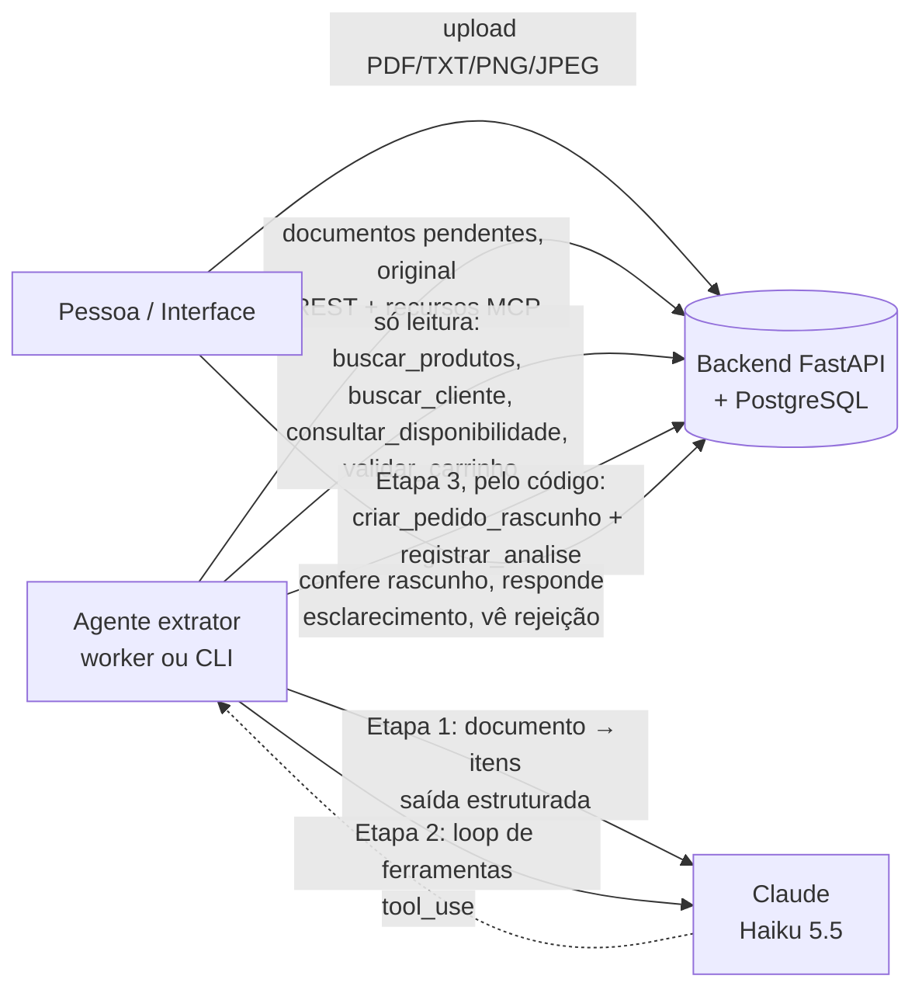

# Arquitetura do agente de extração

O agente transforma um pedido desestruturado (PDF, TXT ou imagem) em um **rascunho de pedido**,
em um **pedido de esclarecimento** ou em uma **rejeição** justificada. Ele combina um modelo
multimodal (Claude) com ferramentas de catálogo expostas por MCP e com verificações
determinísticas que conferem cada decisão antes de qualquer gravação.

Princípio: **o modelo propõe, o código verifica**. O modelo nunca tem acesso a ferramentas que
gravam dados.

## Componentes

| Componente | Responsabilidade | Onde |
|---|---|---|
| Backend | Catálogo, clientes, preços, estoque, documentos, rascunhos e análises; valida tudo no servidor | `src/pedidos/` |
| Servidor MCP | 7 ferramentas tipadas + documentos como recursos | `src/pedidos/mcp_server.py` |
| Agente | Ingestão, extração, resolução, guardrails, orquestração | `src/extrator/` |
| Worker | Ciclo de processamento com orçamento diário e disjuntor | `src/extrator/worker.py` |
| Interface | Status, painel de resultado, selo e filtro de revisão | `src/pedidos/static/` |

O agente roda em container próprio (perfil `agente`), sem credenciais do banco, sem volumes e
sem `data/` (os gabaritos ficam fora da imagem). Fala com o backend apenas por MCP Streamable
HTTP e REST, com o token do grupo.

## Fluxo de um documento

1. **Ingestão** (`ingestao.py`). O original é baixado pelo recurso MCP e conferido contra o
   SHA-256 registrado no upload. TXT vai como texto dentro de `<documento>…</documento>`, com
   tags de delimitação ou de sistema neutralizadas. PDF e imagem vão **nativos** ao modelo
   (base64). O texto do PDF, quando há camada de texto, é extraído só como referência para os
   guardrails. Documentos fora dos limites (páginas, caracteres, tamanho de imagem) viram
   esclarecimento sem chamar o modelo.
2. **Etapa 1 — extração** (`extracao.py`). Uma chamada com saída estruturada (JSON Schema
   estrito): cliente, itens com descrição, códigos, quantidade *como escrita*, embalagem,
   trecho de evidência literal e trechos que tentam dar ordens ao sistema.
3. **Guardrails da Etapa 1** (`guardrails_extracao.py`). Evidência literal no documento, EAN/SKU
   ancorados, quantidade calculada por parser determinístico, sanidade e sinais de injeção.
   Itens com quantidade inválida ou código não confirmável já recebem decisão aqui.
4. **Etapa 2 — resolução** (`resolucao.py`). Só para itens sem bloqueio. O modelo recebe os
   itens verificados (não o documento) e usa as quatro ferramentas de leitura; cada busca de
   produto informa o `item_idx`, e a ponte registra a proveniência de cada resultado. Termina
   com a ferramenta `concluir_analise`, que traz uma decisão por item.
5. **Guardrails da Etapa 2** (`guardrails_resolucao.py`). Proveniência por item, código exato,
   proibição de substituir, atributos e ambiguidade, cliente, itens extras, cobertura,
   consolidação e coerência da decisão. A gravidade só sobe.
6. **Revalidação e ação** (`orquestrador.py`). Se a decisão é rascunho, o código chama
   `validar_carrinho` e depois `criar_pedido_rascunho` com chave de idempotência
   `agente:<documento>:<versão do prompt>`. Em todos os casos, grava a análise com
   `registrar_analise`: decisão, perguntas, motivos, itens extraídos, tokens, custo, latência,
   revisão obrigatória e guardrails acionados. Em esclarecimentos, grava também as
   **pendências** (cliente e itens com opções), completadas por buscas só de leitura, sem o
   modelo, quando a Etapa 2 não trouxe candidatos.

## Pontos de decisão humana

| Situação | O que a pessoa faz |
|---|---|
| Rascunho criado | Confere e confirma fora do sistema; o rascunho não reserva nem baixa estoque |
| Rascunho com **revisão obrigatória** | Confere com prioridade; os motivos aparecem no selo (documento escaneado, item casado só por descrição, possível injeção, extração suspeita, total ou quantidade acima do limite, decisão alterada por guardrail) |
| Pedido de esclarecimento | Obtém a resposta do cliente e resolve no formulário do documento: escolhe entre as opções sugeridas (ou busca no catálogo), confirma quantidades e cliente; o backend valida e cria o rascunho, registrando uma análise `humano`. Reenviar um documento corrigido continua possível |
| Rejeição | Vê o código e o motivo (produto inexistente, inativo, sem estoque, quantidade inválida) |
| Falha de processamento | Vê o motivo (recusa do modelo, teto de custo, tempo excedido) e reprocessa se fizer sentido |

## Decisão: sem OCR dedicado

PDF e imagem são enviados nativamente ao modelo, que recebe texto e imagem de cada página.
Isso preserva o layout (rótulos e valores de tabelas) e evita um segundo componente com erros
próprios. A avaliação confirmou a escolha: os três modelos acertaram os 10 PDFs escaneados e as
3 fotos sem camada de texto (100%), com a mesma precisão dos originais.

Sem camada de texto, porém, os guardrails de evidência literal não podem ser aplicados. Esses
rascunhos recebem sempre `texto_nao_verificavel` e vão para revisão obrigatória.

OCR clássico (Tesseract) só entraria num modo local com modelo pequeno (Ollama), por exigência
de privacidade estrita. Esse modo não foi implementado.

## Decisão: modelo

Critério definido antes da avaliação: o mais barato com acerto do carrinho até 5 p.p. abaixo do
Opus 5.5 no conjunto original e zero EAN alucinado. Resultado em 40 casos (detalhes em
[avaliacao.md](avaliacao.md)):

| Modelo | Acerto do carrinho | Custo médio por documento | Latência p95 |
|---|---|---|---|
| Claude Haiku 5.5 | 100% | US$ 0,0010 | 8,1 s |
| Claude Sonnet 5.5 | 100% | US$ 0,0158 | 9,0 s |
| Claude Opus 5.5 | 100% | US$ 0,0299 | 12,1 s |

Escolhido: **Haiku 5.5** (`LLM_MODEL=claude-haiku-5-5`). O empate em 100% indica que o
conjunto sintético não distingue os modelos; a escolha deve ser reavaliada com documentos reais.
O modelo é configurável, e os demais foram testados no mesmo pipeline.

## Uso da API do Claude

| Aspecto | Implementação |
|---|---|
| SDK | `anthropic` oficial, `AsyncAnthropic`; sem camadas de compatibilidade |
| Raciocínio | `thinking: adaptive`, profundidade por `output_config.effort` (`LLM_EFFORT`, padrão `medium`); sem `temperature` nem `budget_tokens` |
| Etapa 1 | `output_config.format` com schema gerado por `anthropic.transform_schema`; `stop_reason` verificado **antes** de validar o JSON |
| Etapa 2 | Ferramentas cliente com `strict: true` e `tool_choice: auto`; schemas MCP convertidos (sem `$ref` e sem restrições que o modo estrito não aceita — o backend continua validando) |
| Recusas | `fallbacks: "default"` (beta `server-side-fallback-2026-07-01`) em Sonnet/Opus; Haiku 5.5 não tem fallback de servidor, e a recusa vira `falha` registrada |
| Cache | System prompt e ferramentas com `cache_control`; histórico do loop com cache automático. No smoke, de 4 mil a 11 mil tokens por documento vieram do cache |
| Erros | Autenticação/indisponibilidade são transitórias: o documento fica pendente e conta para o disjuntor. Recusa, truncamento e saída inválida viram `falha` |

## Operação

- **Worker** (`python -m extrator.worker`): a cada `AGENTE_INTERVALO_S` (30 s), lista os
  documentos `aguardando_agente` e os processa em ordem de chegada. Para ao atingir
  `AGENTE_ORCAMENTO_DIARIO_USD`, somado pelo endpoint `/api/analises/custo`. Abre o disjuntor
  após `AGENTE_DISJUNTOR_FALHAS` falhas seguidas, com espera exponencial até 1 h. Encerra de
  forma limpa com SIGTERM.
- **CLI** (`python -m extrator processar <id>… | --pendentes`): mesmo caminho, sob demanda.
- **Idempotência:** documento com pedido ou com análise da versão de prompt atual é pulado.
  Mudar o prompt exige nova `VERSAO_PROMPT`.
- **Observabilidade:** um log por documento com ID, SHA-256, decisão, modelo, tokens, custo e
  latência, nunca o conteúdo. A análise gravada guarda os mesmos números e a decisão original
  do modelo, para auditoria.

## Limitações conhecidas

- Uma única versão de layout nos documentos sintéticos; os scans têm boa qualidade.
- A ambiguidade de produtos depende dos candidatos devolvidos pela busca (até 20 por consulta).
- Não há resposta automatizada ao cliente: as perguntas de esclarecimento são exibidas para uma
  pessoa encaminhar, e a resolução é feita por ela na interface. Esclarecimentos sem itens
  estruturados (documento fora dos limites, nenhum item identificado) exigem reenvio.
- A resolução humana usa a chave compartilhada do grupo: não registra qual pessoa resolveu.
- O worker é único. Dois workers simultâneos podem processar o mesmo documento; a idempotência
  impede pedidos duplicados, mas a segunda análise falha por conflito de chave.
