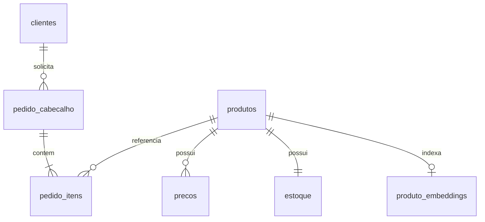

# Modelo de dados — v1

Escopo: um catálogo de mercearia, uma moeda (BRL), um depósito e vendas em unidades
inteiras da embalagem cadastrada. Não inclui ERP real, OCR, agente, pagamento,
faturamento ou confirmação de compra. O agente só cria **rascunhos**.

| Tabela | Identificador e regras |
|---|---|
| produtos | UUID; SKU e EAN únicos; EAN armazenado como texto; marca, categoria, unidade, embalagem e descrição de busca |
| precos | UUID; FK produto; valor decimal positivo; intervalo de vigência [início, fim), sem sobreposição por produto |
| estoque | PK/FK produto; quantidade total e reservada; disponível = total − reservada; valores não negativos |
| clientes | UUID; código único; nome e email fictícios; situação ativa |
| pedido_cabecalho | UUID; FK cliente; status rascunho; data UTC; total decimal; chave de idempotência única e hash do conteúdo |
| pedido_itens | UUID; FK pedido/produto; uma linha por produto; quantidade inteira positiva; snapshots de EAN, nome, unidade, embalagem e preço |
| produto_embeddings | PK/FK produto; vetor de 384 dimensões, modelo, hash do conteúdo e data; índice derivado reconstruível |

## Regras de negócio

- A unidade `UN` representa **uma embalagem vendável** do cadastro. Um pacote de
  café de 500 g é uma unidade; caixas e pacotes diferentes devem ter SKUs próprios.
- Não converter caixas, pesos ou medidas sem informação explícita do catálogo.
- Todos os produtos, clientes, preços e estoques devem ser validados no servidor.
- Valores recebidos do agente não são aceitos como preços ou totais.
- Sem preço vigente, produto inativo ou quantidade acima da disponibilidade:
  validação retorna problema; criação não grava nenhuma linha.
- Produtos repetidos devem ser consolidados pelo consumidor; requisições
  duplicadas no mesmo carrinho são rejeitadas, sem soma silenciosa.
- Criar rascunho grava cabeçalho e itens em uma transação, sem reservar estoque.
- Repetir a mesma chave e o mesmo conteúdo retorna o mesmo pedido; conteúdo
  diferente gera conflito. A ordem das linhas não altera a identidade do pedido.
- Confirmação, reserva e baixa de estoque são uma evolução futura, com revalidação
  transacional e aprovação humana. Um rascunho não garante disponibilidade futura.
- Preços e identidade comercial ficam preservados nos itens mesmo após alterações
  posteriores no catálogo. Não excluir fisicamente registros já referenciados.

## Dados e privacidade

Somente dados sintéticos. EANs têm formato/checksum demonstrativo e não representam
registro GS1. Emails usam domínio reservado. PDFs/TXTs e seus gabaritos são fixtures
locais, não conteúdo do índice de produtos e não são expostos pelo MCP.
