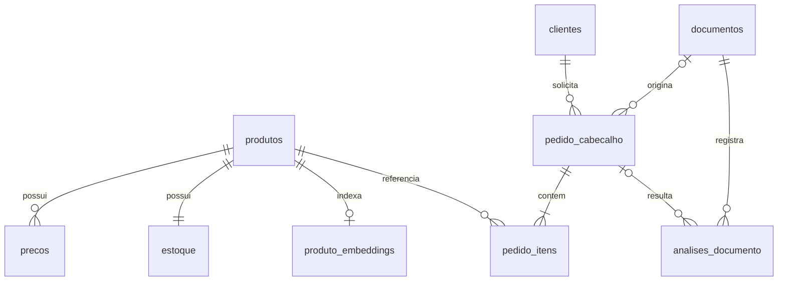

# Modelo de dados — v1

Escopo: um catálogo de mercearia, uma moeda (BRL), um depósito e vendas em unidades
inteiras da embalagem cadastrada. Não inclui ERP real, OCR, agente, pagamento,
faturamento ou confirmação de compra. O agente só cria **rascunhos**.

| Tabela | Identificador e regras |
|---|---|
| produtos | UUID; SKU e EAN únicos; EAN armazenado como texto; marca, categoria, unidade, embalagem e descrição de busca |
| precos | UUID; FK produto; valor decimal positivo; intervalo de vigência [início, fim), sem sobreposição por produto |
| estoque | PK/FK produto; quantidade total e reservada; disponível = total − reservada; valores não negativos |
| clientes | UUID; código único; nome e email fictícios; situação ativa |
| pedido_cabecalho | UUID; FK cliente; status rascunho; data UTC; total decimal; chave de idempotência única e hash do conteúdo |
| pedido_itens | UUID; FK pedido/produto; uma linha por produto; quantidade inteira positiva; snapshots de EAN, nome, unidade, embalagem e preço |
| produto_embeddings | PK/FK produto; vetor de 384 dimensões, modelo, hash do conteúdo e data; índice derivado reconstruível |
| documentos | UUID; nome original, tipo (PDF, TXT, PNG ou JPEG), tamanho, SHA-256, chave física única e data; original guardado em volume persistente |
| analises_documento | UUID; FK documento (RESTRICT) e pedido opcional; decisão, perguntas, motivos, extração (JSONB, sem texto bruto), modelo, versão de prompt, tokens, custo, latência, revisão obrigatória, guardrails acionados e pendências estruturadas (JSONB, só em esclarecimentos); chave de idempotência única e hash do conteúdo |

## Regras de negócio

- A unidade `UN` representa **uma embalagem vendável** do cadastro. Um pacote de
  café de 500 g é uma unidade; caixas e pacotes diferentes devem ter SKUs próprios.
- Não converter caixas, pesos ou medidas sem informação explícita do catálogo.
- Todos os produtos, clientes, preços e estoques devem ser validados no servidor.
- Valores recebidos do agente não são aceitos como preços ou totais.
- Sem preço vigente, produto inativo ou quantidade acima da disponibilidade:
  validação retorna problema; criação não grava nenhuma linha.
- Produtos repetidos devem ser consolidados pelo consumidor; requisições
  duplicadas no mesmo carrinho são rejeitadas, sem soma silenciosa.
- Criar rascunho grava cabeçalho e itens em uma transação, sem reservar estoque.
- Repetir a mesma chave e o mesmo conteúdo retorna o mesmo pedido; conteúdo
  diferente gera conflito. A ordem das linhas não altera a identidade do pedido.
- Confirmação, reserva e baixa de estoque são uma evolução futura, com revalidação
  transacional e aprovação humana. Um rascunho não garante disponibilidade futura.
- Preços e identidade comercial ficam preservados nos itens mesmo após alterações
  posteriores no catálogo. Não excluir fisicamente registros já referenciados.
- `pedido_cabecalho.documento_id` é uma FK opcional com exclusão restrita. Um documento
  pode originar mais de um rascunho, por exemplo numa revisão; a chave de idempotência
  continua identificando uma operação. Rascunhos anteriores não exigem documento.
- A situação do documento é derivada dos pedidos vinculados e, sem pedido, da análise mais
  recente, evitando duplicar estado.
- Análise com decisão `criar_rascunho` exige pedido do mesmo documento (CHECK de coerência no
  banco e validação de vínculo no servidor); `pedir_esclarecimento` exige pergunta.
- Textos livres das análises são gravados com CPF, CNPJ, telefone e e-mail mascarados.
- Um esclarecimento resolvido por uma pessoa gera um rascunho (chave `humano:<analise_id>`) e
  uma nova análise `criar_rascunho` com modelo `humano`; a análise original é preservada.

## Integridade e índices

Todas as entidades têm PK. EAN, SKU, código do cliente, chave de idempotência e chave
física do arquivo têm UNIQUE. EAN-13 é validado por formato e checksum no PostgreSQL.
FKs impedem referências inexistentes e preservam o histórico; não há exclusão em cascata
de pedidos ou itens.

As FKs têm índice correspondente: produto em preços/itens, cliente/documento em pedidos,
pedido em itens; estoque e embeddings usam a própria PK/FK. PKs e UNIQUEs já criam
índices B-tree. Pedidos e documentos usam `(criado_em, id)` para ordenação estável;
documentos também têm índice de SHA-256. Vigências de preço usam exclusão GiST para
impedir sobreposição. A busca vetorial é exata para este catálogo pequeno; um índice
aproximado adicional só deve ser incluído após medição com volume maior.

## Dados e privacidade

Somente dados sintéticos. EANs têm formato/checksum demonstrativo e não representam
registro GS1. Emails usam domínio reservado. PDFs/TXTs e seus gabaritos são fixtures
locais e não compõem o índice de produtos. Documentos ficam acessíveis pelo MCP
somente após upload explícito; gabaritos nunca são servidos.
